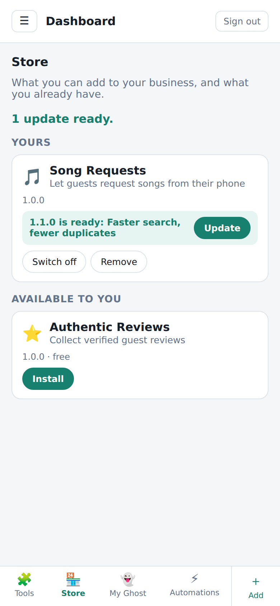
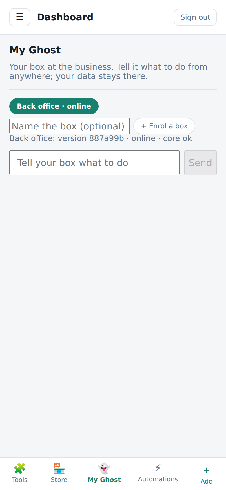
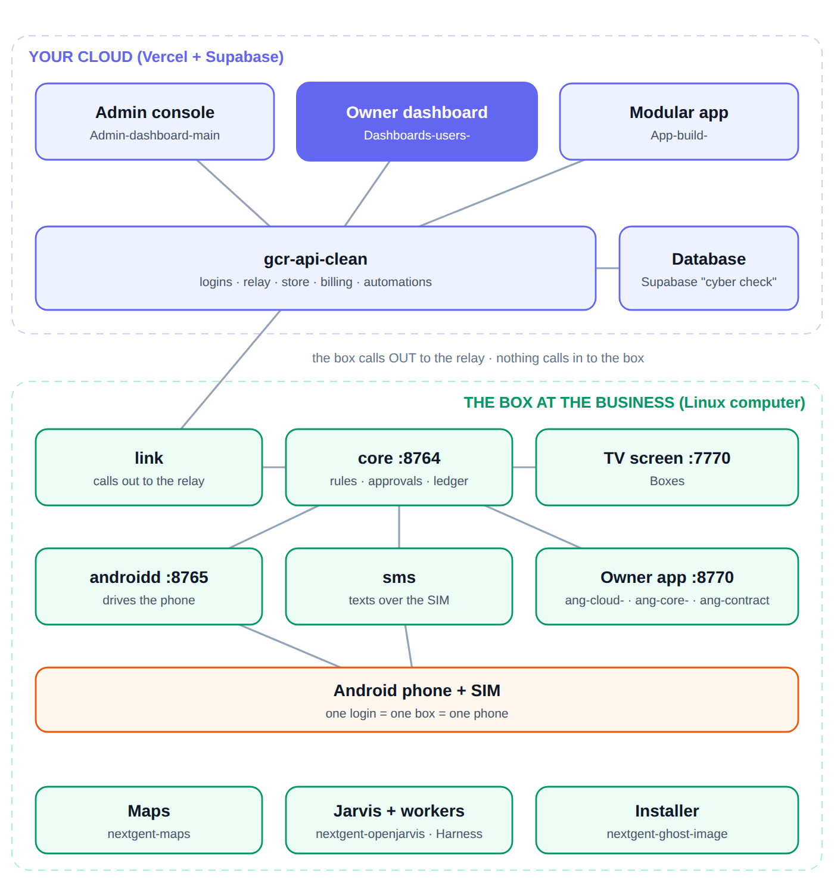

# Business dashboard

> Status: current — last verified against code 2026-11-02 (commit aac903f)

## What it is

**The dashboard a business owner logs into: one business, identified by its
slug.** A static, phone-first React 19 / Vite 8 app (no router, bottom bar instead
of a sidebar, oxlint). Its sections are generated from the database schema via the
API, not hardcoded per business or industry. It is not the operator console; that
is `Admin-dashboard-main`.

The package is still called `dashboard-shell` (it was copied from the repo
`admin-dashboard-`); treat this repo as the one to work on. Production:
`dashboards-users.vercel.app` (unverified from here).

## Where it fits

**Ecosystem rule: only `gcr-api-clean` touches the live cloud database** (Supabase
project `cyber check`, ref `mkepugvdlktfsossumox`). This app, the operator console
and `gcr-unified` call only that API. This app holds no database key and opens no
database connection. The home machine has its own local Supabase, separate from this.

- **Calls**: `gcr-api-clean` through `src/lib/apiClient.js` (session token from
  `/api/business-auth`, kept in `localStorage`). Which business you are comes from the
  session, never from anything the browser sends. The one exception is the **Platform**
  tab, which logs in to a separate Paperclip server through the `api/paperclip/[...path].js`
  edge function (forwards `/api/paperclip/*` to `PAPERCLIP_SERVER_URL`; answers 503 when
  unset; the clean version forwards every method and path it is given).
- **Called by**: nobody. The operator console links here ("View as", `?business=<slug>`).
- In the Ghost system this is a cloud-side screen. It never talks to a Ghost box
  directly: "My Ghost" queues a request at the API, the box pulls it over its own
  outbound link and posts the answer back (`src/pages/Ghost.jsx`).

| Store | My Ghost |
| --- | --- |
|  |  |

*Captured against a test backend with sample data (one installed app with an
update waiting, one free app available, one online box).*

**Store** shows what the operator made available to this business (free, in its
plan, or granted), lets it install, switch off, configure and remove apps, and
pull updates. An update that asks for more access is never applied without the
owner saying yes. **My Ghost** is the business's own box, reachable from anywhere
through the relay: enrol a box (the page shows a one-time token to put in
`~/.config/ghost/ghost.env` as `NEXTGENT_NODE_TOKEN`), see it online, tell it
what to do, see whether it needs a YES text and the verified result; the example
phrases it suggests come from the box itself. **Automations** lists what the
operator pushed to this business. **Tools** connects third-party accounts
(Composio) through `/api/connections`.



---

Every business gets sections built from its own data. Nothing is hardcoded per
business or per industry.

A business is identified by its **slug** (`flora-bama-yacht-club`). Everything
about it lives in tables carrying an `entity_slug` column. The dashboard has no
list of features: it asks the database what tables exist, pulls the rows
belonging to that slug, and turns every table that has data into a section. A
restaurant ends up with Menu, Hours, Happy Hour. A charter ends up with Trips,
Species, Meeting Points, Weather Rules. Same code, different data.

Add a table to the database and it appears in every business that has data in
it. Drop it and the section disappears. No deploy, no code change.

The business decides what goes in their dashboard. The **Add** tab lists every
slug table the schema supports that they aren't using yet — grouped, searchable,
including tables nobody has written any code for. Pick one, fill in the form
built from that table's columns, and it becomes a live section. A business with
nothing entered starts from that catalog rather than an empty screen.


## Branches

The default branch on GitHub is `claude/dashboard-inventory-purposes-m5wtba`, the line
this README describes. Branch counts drift; run `git ls-remote --heads origin` and check
any branch you care about before assuming this one is the whole story.

## Run and test

```bash
npm ci
npm run dev      # http://localhost:5173
npm run build    # production build into dist/
npm run check    # scripts/check-discovery.mjs: discovery and table-mapping checks, no network
npm run lint     # oxlint
```

Results on 2026-11-02, Node 22 with `npm ci`, at commit aac903f: `npm run lint` passes (0
errors, 3 warnings), `npm run check` prints "All checks passed", `npm run build` passes.
There is no CI workflow, no unit-test runner and no `verify` script. Nothing has been
exercised in a browser against the live API in this pass.

Deploy `dist/` anywhere static. Settings (all optional, copy `.env.example` to
`.env.local`): `VITE_GCR_API_BASE` (defaults to `https://gcr-api-clean.vercel.app`),
`VITE_LOGIN_DOMAIN` (defaults to `biz.gulfcoastradar.com`) and `VITE_REQUEST_TIMEOUT_MS`
(defaults to 30000). The Paperclip proxy needs `PAPERCLIP_SERVER_URL` on the deployment;
for local dev `vite.config.js` proxies `/api/paperclip` to `PAPERCLIP_DEV_SERVER`
(default `http://localhost:3100`).

## Where the data comes from

| What | Endpoint |
| --- | --- |
| Who you are, what you own, admin or not | `GET /api/business/me` |
| Which tables can be sections, and their columns | `GET /api/business/schema` |
| Every section that has rows, in one call | `GET /api/business/sections` |
| Create / update / delete a row | `POST/PATCH/DELETE /api/business/:table[/:id]` |
| Sign up and sign in by phone code | `/api/business-auth/*` |
| The business's public listing payload (`Dashboard.jsx`) | `GET /api/gcr/entity/:slug` |
| Industry list, read live once signed in (the sign-up form uses a built-in list, since no session exists yet) | `GET /api/business/industries` |
| Calendar (iCal feed and imports) | `/api/business/ical` (`Calendar.jsx`) |
| Invite links | `GET /api/auth/invite/:token`, `POST /api/auth/accept-invite` |
| Claim a business | `GET /api/gcr/entities?search=`, `POST /api/gcr/claim` |
| Tools (Composio connections) | `/api/connections` (`GET`, `:toolId/connect`, `:toolId/refresh`, `DELETE :toolId`) |
| Store | `/api/store` (`GET`, `:id/install`, `:id/update`, `:id/disable`, `:id/enable`, `DELETE`, `PATCH :id/config`) |
| My Ghost | `/api/nodes` (enrol, list, send a request, read the answer) |
| Automations | `/api/business/automations` |

Hosts live in `src/lib/config.js`; every path lives once in `src/lib/endpoints.js`.

### The API renames tables

`buildFullEntity()` in gcr-api-clean reshapes some tables before sending them —
`entity_hours` arrives as `hours`, `entity_offer_fee` as `fees`. `src/lib/tableMap.js`
maps those names back, which is what lets an API-supplied section be edited (the
write has to name a real table). Anything not in the map is assumed to already be
a real table name, so a table added tomorrow still works untouched.

## The files that matter

**Engine — `src/lib/`**

| File | What it does |
|---|---|
| `schemaDiscovery.js` | Asks `GET /api/business/schema` which tables carry an `entity_slug` and what their columns are, so edit forms build themselves. |
| `entityTables.js` | Loads every section that has rows with one call to `GET /api/business/sections` and caches it for five minutes. |
| `discoverSections.js` | Turns raw results into sections. Merges the API payload with the swept tables, labels and icons them. |
| `sectionCatalog.js` | The other half — everything the business *could* add but isn't using yet. Internal tables (AI indexes, access control, audit/log/analytics tables, other people's Trip Swipe data, SMS/message tables, backups) are hidden everywhere. Tables that other people write to (bookings, orders, customers, requests, leads and the like) still show as sections once they have rows but are never offered under Add. |
| `tableMap.js` | API payload key ↔ real table name. |
| `gcrApi.js` | The gcr-api-clean calls for entity search and claim. |
| `writeEntityData.js` | **Every write goes through here.** It sends no slug: the API takes the business from the session and puts it in the WHERE clause itself. |
| `AuthContext.jsx` | Sign in, session, access. Resolves which business you are from `entity_owners`, admin status from `platform_admins` — both server-side. |
| `config.js` | The API host, the sign-in login domain and the request timeout. No database host or key. |
| `apiClient.js` / `endpoints.js` | The fetch wrapper (session token, typed errors) and every API path, once. |
| `authStore.js` | Where the session lives (`localStorage`), token renewal, and the slug an admin is acting on. |
| `shapes.js` | Works out from a table's columns and rows whether it is a progress bar, a price list or a fan-submitted inbox, and masks other people's contact details. |
| `appStore.js` / `automations.js` / `calendar.js` / `paperclip.js` / `industries.js` / `useTheme.js` | Calls and helpers for Tools, Automations, the Calendar, the Paperclip proxy, the industry list and the light/dark/auto theme. |

**Screens — `src/pages/`** — `Login`, `SignUp`, `AcceptInvite`, `Claim`, `Dashboard`, `BusinessPicker` (admin only), `Store`, `Ghost` (My Ghost), `Automations`, `AppStore` (Tools, the Composio connections), `Calendar` (iCal import and export), `Platform` (Paperclip login and store, through `api/paperclip`).

**Layout — `src/components/`** — `TopBar`, `BottomNav` (one tab per discovered
section plus seven fixed tabs: Calendar, Tools, Platform, Store, My Ghost, Automations and Add; mobile-first, no sidebar), `MainContent`,
`AddSection` (the catalog), `RowEditor` (builds a form from a table's columns),
`AppStoreView` (the Tools list).

**Sections — `src/sections/`** — `GenericSection` renders *any* table by
inspecting the shape of its rows. `registry.jsx` maps a handful of purpose-built
renderers; it does **not** define which sections exist — discovery does.

## Artist module

Artists are businesses like any other — same slug, same discovery, same editor.
Most of the module already exists in the database (`artist_profiles`, `songs`,
`song_requests`, `shoutouts`, `artist_goals`, `song_cooperatives`, `tip_links`,
`artist_shows`, `artist_follows`, `artist_booking_requests`).

What did not exist is the part the artist needs to control: **what anything
costs.** `sql/artist_module.sql` adds it (the file's own header calls it a
proposal: "NEVER RUN") —

| Thing | Where the artist sets it |
|---|---|
| Price per song | `songs.price` (falls back to `artist_profiles.default_min_request_amount`) |
| Custom-song price | `artist_profiles.custom_song_price` |
| Shoutout tiers | `artist_price_tiers` where `kind = 'shoutout'` |
| Tip buttons | `artist_price_tiers` where `kind = 'tip'` |
| Crowdfund amounts | `artist_price_tiers` where `kind = 'crowdfund'` |
| Crowdfund targets | `artist_goals`, `song_cooperatives` |
| Cash App / Venmo / PayPal | `tip_links` (platform, handle, deep-link prefix) |
| Requests open right now | `artist_profiles.requests_open` |

`artist_price_tiers` is one table behind every money button on the fan pages, so
a new kind of paid thing is a row — not a schema change and not a deploy.

**Nothing about this is hardwired.** `src/lib/artistModule.js` contains only
nicer words — labels, icons, and a name pattern for catalog grouping. Delete it
and the artist dashboard still works; it just says "Artist Price Tiers" instead
of "Prices". Every decision that matters is made from the live schema and the
shape of the rows, in `src/lib/shapes.js`:

| Decision | How it's made |
|---|---|
| Which sections exist | Tables with rows for this slug |
| What you can add | Every slug table you aren't using yet |
| Progress bar or not | Row has a raised/target numeric pair |
| Price layout or not | Rows have a kind + label + amount |
| Held back from Add | Row carries somebody else's identity, or the name says it collects submissions |
| Contact masking | Field name matches a contact convention |

A `merch_crowdfund` table invented tomorrow gets a progress bar. A
`sponsor_tiers` table gets the grouped price layout. A `wish_wall` table with a
`patron_phone` column is recognised as fan-submitted and held out of the Add
catalog with its phone numbers masked. None of those names is used in the code: the only
mentions in `src/` are two example comments in `src/lib/shapes.js`. `npm run check`
(`scripts/check-discovery.mjs`) feeds the detectors tables invented like these and
asserts they get the right treatment.

Fan-submitted tables still show as sections once they have rows (that's the
artist's queue); they're just never offered as something to *add*, because the
artist isn't the author.

**The fan-facing pages live in `gcr-unified`, not here** — `/artist/:slug` and
`/artist/:slug/live`. They currently hardcode their amounts; once this SQL is
run they should read `artist_price_tiers` and `tip_links` instead. See
`docs/PORT_REVIEW.md`.

## Access

Which business you are, and whether you are an admin, is decided by
`gcr-api-clean` from your session: `entity_owners` links a login to a business,
`platform_admins` lists admins. The database functions `owns_entity` and
`is_platform_admin` from `sql/ownership_and_write_access.sql` exist on the live
database. `sql/entity_sections.sql` is **not** applied and is no longer needed
(the API does that sweep).

**A login only reaches a dashboard once it has a row in `entity_owners`.** A read-only
audit on 2026-11-02 found exactly one row there (and one platform admin) on the live
database, so the dashboard has hardly been used by real owners. Claims, invites and
`sql/seed_first_owner.sql` are the ways to create more.

Provision logins with `scripts/provision-accounts.mjs` (dry-run first; it needs
the service key in the environment, and writes credentials to
`business-credentials.csv`, which is gitignored and should be treated as secret):

```bash
SUPABASE_SERVICE_KEY=<service_role key> node scripts/provision-accounts.mjs --dry-run --limit=5
```

These scripts hardcode the live project's URL and use the service key directly, so they
**bypass the API**; they are operator tools, not part of the app. Do not paste a service
key anywhere else. `scripts/make-setup-links.mjs` (same key) writes one-time password-setup links to
`setup-links.csv`, also gitignored. `scripts/reconcile-tables.mjs` and
`scripts/build-reconciliation-page.mjs` read `docs/reconciliation/`, which is not
in this repo, so they cannot run as checked in.

Ways in, as built: a texted six-digit code (`Login.jsx`), a business login and
password for provisioned or invited accounts, an invite link (`?token=`,
`AcceptInvite.jsx`), a claim, or a new sign-up (`SignUp.jsx`: phone, code,
business name, industry; the listing stays hidden until reviewed).

**Admin deep link** — `https://<dashboard-host>/?business=<slug>` opens that business's
dashboard with an "Admin view" banner for a signed-in admin (`AuthContext.jsx`); with no
`?business=`, admins land on the searchable picker. The operator console's newer "View as"
adds a one-time `&pass=` to that link, but **this dashboard never reads `pass` and never
calls `/api/business-auth/exchange-impersonation`**, so the pass flow does not sign
anyone in here. For an admin acting on a business the client adds `slug` to
`/api/business/*` calls only (`apiClient.js`); `/api/store`, `/api/connections` and
`/api/nodes` get no slug.

## Automations

The operator builds automations and scripts in `Admin-dashboard-main` and
pushes them here — a "cloud update" for dashboards. The **Automations** tab
(`src/pages/Automations.jsx`) shows what was pushed to this business, at the
version it was given: switch each one on or off, fill in the settings it asks
for, run it now, pull a newer version when one is waiting, copy or replace the webhook
URL that runs it, and open its run history to see what every step did.

Nothing is built on this side. Everything goes through
`/api/business/automations` on gcr-api-clean, scoped by the session like the
rest of `/api/business`. The two tables behind it (`entity_automations`,
`automation_runs`) carry `entity_slug` but are held back from section discovery
by the API, so they never appear as editable sections or in the Add catalog.

## Claims

A business without a login uses **Claim your business** on the sign-in screen.
That searches `GET /api/gcr/entities` and posts to `POST /api/gcr/claim`, which
writes a `business_claims` row with status `new`. It grants nothing on its own —
an admin reviews it through `GET /api/admin/gcr/claims` and
`PATCH /api/admin/gcr/claims/:id`. Those two only list the claims and set their
status and notes; the login and the `entity_owners` row are created by a separate
admin step (for example `POST /api/admin/link-user`). The `admin.html` GCR Claims
panel in cybercheck-login that this flow was written against is not in this
workspace, so its behaviour is not checked here.

## Known gaps

- **Not proven end to end on the live stack**: a real business signing in and editing.
  Deployed state is unverified from here.
- **Hours and tags rows cannot be edited**: `EditableSection.jsx` disables a row with no
  `id`, and the API payload's hours and tags rows carry none.
- **What a business may write** is decided by the API (`lib/businessTables.js` in gcr-api-clean holds the allow-list), not by the Add catalog here.
- **Whole-dashboard refetch after every save**: a save bumps `reloadKey` in `Dashboard.jsx`,
  which re-fetches the full entity payload and re-sweeps the tables (not a browser reload,
  but the whole view reloads).
- **Admin "View as" pass is not exchanged** and the admin slug is not sent for
  `/api/store`, `/api/connections` and `/api/nodes` (see Access).
- **No URL routing**: the app switches views with state (`showStore`, `showGhost`, …) in
  `Dashboard.jsx`, so no tab has its own URL and the back button leaves the app.
- **Platform tab** uses its own Paperclip login (cookie session, separate from the business
  session); the proxy forwards any method and path it is given.
- **Session token in `localStorage`** (`authStore.js`).
- **Operator scripts bypass the API** (see Access), and `docs/everything.html` embeds an
  anon-role key for the live project. The live database has anon write grants revoked, but
  rotate if in doubt.
- **`sql/artist_module.sql` is a proposal** ("NEVER RUN" in its own header) and the
  fan-facing artist pages in `gcr-unified` do not read it.
- **`docs/PORT_REVIEW.md` is partly out of date**: it describes a browser Supabase client
  and anon key (none in `src/`) and lists Composio connections and any app concept as
  "not built at all", although `src/pages/AppStore.jsx` and `src/pages/Store.jsx` exist.
- The API line this talks to has open security gaps and two unreconciled git lines; see the
  `gcr-api-clean` README. A merge of its `main` into the integration line with those
  protections is prepared but not published.

`docs/everything.html` is the full record of the original port (architecture write-up,
product spec, reconciliation of the 244-table design against the 563-table database then
live; the live database now has 697 public tables). Open it in a browser; it needs no
server.

## Related repos

`gcr-api-clean` (the API and the only database client), `Admin-dashboard-main` (operator
console), `gcr-unified` (public tourist site), `node-foundation` (home-machine monorepo and
index of the system), and the `nextgent-*` repos.
